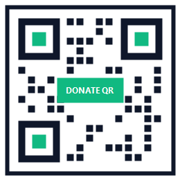

# ⚡ PaidAttention — Pay Attention Online

[](LICENSE)
[](#how-it-works-in-detail)
[](#for-creators--websites-monetize-in-60-seconds)

**PaidAttention** is a free, open-source browser extension and wallet that replaces annoying monthly subscriptions and clickbait ads with **automatic micro-payments for the time you genuinely spend reading, watching, or listening online**.

Whenever you *pay attention* to something online, you effortlessly support the person who created it—**except for clickbait, which gets nothing.**

---

## 🌟 Why PaidAttention?

### For Readers, Viewers & Listeners
* **⏱️ 15-Second Free Preview (Zero Clickbait):** Every page starts with a 15-second free countdown. If an article or video turns out to be clickbait and you close the tab within 15 seconds, you pay **$0.00**.
* **🛑 Never Pay Extra for Reading Slowly:** Every article, song, or video has a tiny, fixed maximum cap (for example, $0.015 for an article). Once you reach it, the meter stops completely—so you can take your time, re-read paragraphs, or leave the tab open at **$0.00/sec**.
* **👍 "Boost" What You Love for Free:** Clicking **👍** on a page you loved **never costs you extra money**. Instead, it automatically shifts more of your daily budget toward the creators you liked and less toward pages you didn't upvote.
* **💳 Strict Spending Limits & Instant Refund:** Your spending is automatically capped at **$3/day** (and **$90/month** across all digital media). Your wallet never holds more than $200, includes a 1-click **Instant Refund** button, and automatically refunds your money if you stop using the app for 60 days.
* **🎁 $2.00 Free Trial:** Try the extension across the web with $2.00 in virtual trial credit before ever connecting a payment method, and see a clear receipt showing how much you save compared to monthly subscriptions.

### For Creators, Bloggers, Musicians & Platforms
* **🚀 Set Up Your Website in 60 Seconds:** Add a single line of HTML to your personal website (or install our 1-click WordPress plugin). You don't even need a crypto wallet upfront—visitor payments accumulate safely for your domain until you're ready to redeem them to your bank account or wallet.
* **🌍 Viral Content Gets Cheaper for Everyone:** Creators set a **Community Buyout Goal** (the amount needed to cover production costs and a fair profit). Once the public collectively reaches that goal, the content becomes nearly free for everyone else in the world.
* **🎬 Works for Solo Bloggers & Streaming Giants:** Supports 100% direct-to-creator payouts for independent blogs, multi-artist splits for bands and co-authors, and platform/creator splits for services like YouTube or Netflix.
* **🤖 Fair Payouts from Open-Source AI:** When open-source AI assistants use articles or websites to answer questions, PaidAttention automatically splits the fee so 70–75% goes directly to the original human websites that were cited.

---

## 🚀 Quickstart (Try It in 60 Seconds)

### 1. Load the Browser Extension (Chrome, Brave, Edge)
1. Download or clone this repository.
2. Open `chrome://extensions/` in your browser and turn on **Developer mode** (top-right toggle).
3. Click **Load unpacked** and select the [`extension/`](extension/) folder.
4. Visit any website: you'll see the compact countdown pill (`15s` $\to$ `$0.0001 / $0.015`) and the **`👍`** button in the bottom-right corner!

### 2. Open the Interactive Web App & Creator Studio
Open [`index.html`](index.html) directly in your browser to explore the full interactive dashboard, test the **60-Second Website Monetization Studio**, or connect **MetaMask** on the free **Base Sepolia Testnet**.

---

## 🛠️ For Creators & Websites: Monetize in 60 Seconds

You can start receiving micropayments on your website using any of these three methods:

1. **Method 1 — Direct Wallet (MetaMask — Fastest Payouts):**
   Paste this single line inside the `<head>` of your website:
   ```html
   <meta name="paidattention" content="wallet:0xYourWalletAddress" />
   ```
   *Payments arrive directly in your wallet with $0 transaction fees and zero waiting.*

2. **Method 2 — 60-Second Domain Tag (No Wallet Needed Upfront):**
   Don't have a wallet yet? Just put your website domain:
   ```html
   <meta name="paidattention" content="domain:yourwebsite.com" />
   ```
   *Earnings are held safely for your domain automatically. You can verify ownership and redeem them anytime later via a 1-click FaceID/TouchID Passkey or bank transfer.*

3. **Method 3 — 1-Click WordPress Plugin (Zero Code):**
   Upload [`integrations/paidattention-wordpress/paidattention-wordpress.php`](integrations/paidattention-wordpress/paidattention-wordpress.php) to your WordPress plugins folder and configure it under **Settings → PaidAttention**.

---

## 🔍 How Each Feature Works in Detail

Below is a closer look at how each protection and feature works behind the scenes. *(For the complete mathematical formulas and smart-contract specifications, see [SPECIFICATION.md](SPECIFICATION.md)).*

<details>
<summary><strong>1. 🛡️ How the 15-Second Countdown & Anti-Clickbait Curve Work</strong></summary>
<br/>

Traditional paywalls force you to pay before you know if an article is worth reading, while linear streaming meters charge you from the very first second.
- **Free Grace Window:** PaidAttention waits 10–15 seconds before starting the meter. If you bounce early, nothing is charged.
- **Smooth Ramp & Hard Cap:** After the countdown, the payment ramps up smoothly while the tab is actively focused and stops permanently once the item's cap is reached. If you switch to another tab or minimize the window, the meter pauses immediately.
- **48-Hour Re-Read Window:** Once you reach the cap on an article or video, it stays unlocked for 24–48 hours at no extra cost (with anti-piracy limits so a single account cannot illegally re-stream video to thousands of people).
</details>

<details>
<summary><strong>2. 👍 How the "Boost" (Thumbs Up) Quality Pool Works at $0 Extra Cost</strong></summary>
<br/>

On most platforms, tipping a creator costs you extra money out of pocket—and allowing a "Thumbs Down" to pay less would encourage people to downvote everything just to save pennies.
- **Budget-Neutral Rebalancing:** With PaidAttention, there is only a **👍 Boost** button. Whether you click 👍 zero times or ten times in a day, **your total daily spending stays the exact same**.
- **Rewarding Quality:** When you give a 👍 to 2 out of 10 pages you viewed, a portion of your daily spend is automatically pooled and routed to those 2 pages—boosting their creators by up to **2x (+100%)**, while pages that received no 👍 still receive at least **50%** of their base rate.
</details>

<details>
<summary><strong>3. 🌍 Community Buyout Goals & Fair Pricing Alerts</strong></summary>
<br/>

- **Community Buyout Goal:** Creators can set a total earnings target for a piece of work (for example, $500 for an investigative article or $50,000 for an indie documentary) and write a short note explaining why. As more people view the work, its per-viewer price gradually drops until—once the goal is reached—it falls to a near-free maintenance floor for everyone else.
- **Price Gouging Protection:** The app compares every page's rate against the normal average for that category (articles, music, video, courses) and against real-world inflation. If a page tries to charge an unusually high rate, the meter pauses after the free preview and asks for your permission before spending a cent.
- **Monthly Affordability Thermostat:** If average digital media spending across the network ever creeps above ~$90–$100/month (adjusted for inflation and median salaries), the protocol automatically scales prices downward so digital content never eats an unfair share of human income.
</details>

<details>
<summary><strong>4. 🔒 Wallet Security, $0 Transaction Fees & 60-Day Automatic Refunds</strong></summary>
<br/>

- **Independent Non-Amendable Wallet (`ImmutableUserVault.sol`):** Your funds are held in a standalone smart contract outside of governance control—no admin or developer can ever drain, freeze, or change the rules on existing funds.
- **$200 Maximum Balance Ceiling:** To minimize risk, a user wallet cannot hold more than $200 at once (any excess deposit is automatically returned in the same transaction).
- **1-Click Instant Refund & 60-Day Inactivity Refund:** You can withdraw 100% of your remaining balance in one click at any time. If your account is inactive for 60 days, the smart contract automatically refunds your remaining balance back to the exact wallet(s) that funded it in First-In-First-Out order.
- **$0 Transaction Fees:** Micro-payments are batched off-chain and settled on Ethereum Layer-2 (Base / Arbitrum). The tiny blockchain gas fees are paid entirely by the interest generated on idle balances, so users and creators pay **$0.00 in gas fees**.
</details>

<details>
<summary><strong>5. 🕵️ Privacy, Cultural Rankings & Community Grants</strong></summary>
<br/>

- **Complete Financial Privacy:** Your browsing sessions use blinded cryptographic proofs so no public observer can ever link your personal wallet to the articles or videos you viewed. Creators can also use stealth addresses so their total income stays private.
- **Global & Regional Quality Rankings:** Using anonymous regional tags, PaidAttention highlights the highest-quality content (most focused time + highest 👍 ratio) by language, region, and culture—showing what humanity genuinely values spending time on rather than what had the most clickbait views.
- **Zero Protocol Fee Cut (100% to Creators):** PaidAttention takes **0% in developer commissions or pooled fee cuts** from user payments, eliminating any risk of fee-pool abuse. 100% of every micropayment goes directly to the content creators and platforms.
- **3D Worlds & Metaverse Ready:** Includes a spatial trigger API (`SpatialTrigger`) so 3D virtual museums and worlds (such as Decentraland) can start and pause the meter automatically as your avatar walks into and out of a virtual building.
</details>

---

## 📂 Repository Contents

* [`extension/`](extension/) — Security-hardened Chrome / Brave / Edge Extension (Manifest V3) with custom icons
* [`index.html`](index.html), [`app.js`](app.js), [`styles.css`](styles.css) — Interactive Web App & Creator Monetization Studio
* [`integrations/paidattention-wordpress/`](integrations/paidattention-wordpress/paidattention-wordpress.php) — 1-Click WordPress Plugin
* [`contracts/ImmutableUserVault.sol`](contracts/ImmutableUserVault.sol) & [`contracts/OpenStreamProtocol.sol`](contracts/OpenStreamProtocol.sol) — Hardened Ethereum L2 Smart Contracts
* [`SECURITY.md`](SECURITY.md) & [`test/security-pentest.js`](test/security-pentest.js) — Penetration Testing Protocol & Automated Exploit-Defense Test Suite
* [`contracts/DEPLOY_REMIX_GUIDE.md`](contracts/DEPLOY_REMIX_GUIDE.md) — 2-Minute Browser Guide to deploying on Base Sepolia Testnet
* [`SPECIFICATION.md`](SPECIFICATION.md) — Full Technical & Mathematical Whitepaper

---

## 💚 Support the Creator (Direct Donations)

**PaidAttention** is 100% free and takes **0% protocol fees** on your payments. If you find this project useful and would like to support its creator directly, you can scan the donation QR code below:

<!-- Place your personal donation QR code image at assets/donation-qr.png -->
<p align="center">
  
</p>

---

## 📄 License

Dual-licensed under **[GNU AGPLv3 (Core Protocol, Contracts & Browser Extension) + MIT License (`sdk/`, `examples/` & `integrations/`)](LICENSE)**:
- **Core Platform (`AGPL-3.0-or-later`):** Ensures the protocol, browser extension, and AI attribution algorithms remain permanently open-source and prevents closed-source commercial clones.
- **Website Embed SDK & Plugins (`MIT`):** Allows any personal website, blog, WordPress site, newspaper, or streaming service to embed `<meta name="paidattention">` tags with zero legal friction.
